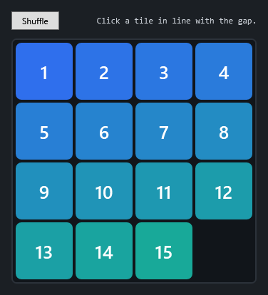

# Sliding Tiles in WPF

> A walk-through that grows a four-rectangle "drag me around" sketch into a complete, animated
> **sliding-tile puzzle** (the classic 15-puzzle). Along the way it covers the WPF `Canvas`, attached
> properties, keeping a model separate from its view, animating attached properties cleanly, and why a
> good shuffle is harder than it looks.

*By Richard Potter. The source discussed here lives in this repository under `src/SlidingTiles/`.*



**Contents**

- [Introduction](#introduction)
- [Where this started](#where-this-started)
- [Step 1 — A model that knows nothing about pixels](#step-1--a-model-that-knows-nothing-about-pixels)
- [Step 2 — Sliding a whole line](#step-2--sliding-a-whole-line)
- [Step 3 — Drawing the board on a Canvas](#step-3--drawing-the-board-on-a-canvas)
- [Step 4 — Animating the slide](#step-4--animating-the-slide)
- [Step 5 — A shuffle that's actually solvable](#step-5--a-shuffle-thats-actually-solvable)
- [Running it](#running-it)
- [Going further](#going-further)
- [Summary](#summary)

---

## Introduction

A sliding-tile puzzle is a perfect small project: the rules fit in a paragraph, but building it well
touches most of the ideas you need for *any* interactive WPF app — positioning, input, animation, and
the discipline of separating what the program *is* (a grid of tiles) from how it *looks* (rectangles
on a canvas). This tutorial builds it step by step and is honest about the traps.

## Where this started

The seed was a tiny demo: a `Canvas` with four coloured rectangles you could drag around with the
mouse by giving each a `TranslateTransform`. It taught one useful thing — mouse capture and transforms
— and nothing else. It had no rules, no goal, and no idea what a "tile" was.

We keep its good idea (tiles positioned freely on a `Canvas`) and add everything that makes it a
*program*: a grid model, legal moves, animation, a shuffle and a win condition. The biggest single
change in mindset is this: **the old demo stored the truth in the UI** (a rectangle's transform *was*
its position). We will instead store the truth in a model and treat the UI as a view of it.

## Step 1 — A model that knows nothing about pixels

[`PuzzleBoard`](src/SlidingTiles/PuzzleBoard.cs) is the whole game, with no reference to WPF. It is a
flat, row-major array of cell values 1…15, with `0` standing for the blank:

```csharp
public PuzzleBoard(int size = 4)
{
    Size = size;
    _cells = new int[size * size];
    for (var i = 0; i < _cells.Length - 1; i++)
        _cells[i] = i + 1;
    _cells[^1] = Blank;   // blank starts bottom-right
}
```

Because it is pure data, the interesting questions are one-liners: `IsSolved` checks each tile is in
its home cell; `LocationOf(value)` finds a tile's row and column. Keeping this UI-free isn't
ceremony — it means the rules can be reasoned about (and unit-tested) without ever opening a window.

## Step 2 — Sliding a whole line

The rule we implement is the satisfying one: clicking **any** tile in the blank's row or column slides
the whole line of tiles between them — not just a single adjacent tile. The trick is to write the
shift *once* and reuse it for both rows and columns by passing in a function that maps a line
coordinate to a flat index:

```csharp
private void ShiftLine(int from, int to, Func<int, int> cellAt)
{
    var step = Math.Sign(from - to);   // walk from the blank toward the clicked cell
    for (var i = from; i != to; i -= step)
        _cells[cellAt(i)] = _cells[cellAt(i - step)];
    _cells[cellAt(to)] = Blank;
}
```

`TrySlide` then just decides which case applies and reports whether anything actually moved:

```csharp
if (row == blankRow)    { ShiftLine(blankColumn, column, c => Index(row, c)); return column != blankColumn; }
if (column == blankColumn) { ShiftLine(blankRow, row, r => Index(r, column)); return row != blankRow; }
return false;   // not in line with the blank — ignored
```

One small idea — passing the row/column-to-index mapping as a lambda — collapses what is usually two
near-identical copies of fiddly shifting code into a single correct one.

## Step 3 — Drawing the board on a Canvas

The view builds one `Border` per tile in code and drops them on a `Canvas`. A `Canvas` is the right
panel here precisely because it does **no** layout of its own — children sit wherever you put them via
the `Canvas.Left` and `Canvas.Top` **attached properties**:

```csharp
Canvas.SetLeft(tile, (column * TileSize) + Gap);
Canvas.SetTop(tile, (row * TileSize) + Gap);
```

Attached properties are WPF's way of letting a parent (`Canvas`) bolt extra data (`Left`, `Top`) onto
children that know nothing about it. The crucial method is `SyncPositions`: it asks the *model* where
each tile belongs and moves the matching `Border` there. The view never decides positions; it only
ever reflects the model.

```csharp
foreach (var (value, tile) in _tiles)
{
    var (row, column) = _board.LocationOf(value);
    MoveTile(tile, (column * TileSize) + Gap, (row * TileSize) + Gap, animate);
}
```

A click, then, is a three-line story: find the tile's cell, ask the model to slide, re-sync the view.

## Step 4 — Animating the slide

Snapping tiles to their new cell works but feels cheap; sliding them is what makes the puzzle pleasant.
We animate the very same `Canvas.Left`/`Canvas.Top` with a `DoubleAnimation` — but there is a genuine
WPF gotcha to navigate here.

By default an animation **holds** its final value forever (`FillBehavior.HoldEnd`), and while it does,
it *shadows* the underlying property. Start a second animation later and things get confusing fast,
because the property you set in code is no longer the value on screen. The clean fix is to make each
animation **stop** at the end and write the final value into the property itself:

```csharp
var animation = new DoubleAnimation(from, to, SlideDuration)
{
    FillBehavior = FillBehavior.Stop,
    EasingFunction = new QuadraticEase { EasingMode = EasingMode.EaseOut },
};

animation.Completed += (_, _) =>
{
    tile.BeginAnimation(property, null);   // detach the (now finished) animation
    tile.SetValue(property, to);           // …and bake the result into the property
};
```

Now `Canvas.Left` is always the single source of truth: between slides it holds the real value, so the
next slide can read it as a starting point and successive moves never fight each other. Reading
`from` with `tile.GetValue(property)` captures the *current* on-screen position even mid-slide, so
fast play stays smooth.

## Step 5 — A shuffle that's actually solvable

The subtle bug waiting in every tile puzzle: **you cannot shuffle by placing tiles at random.** Exactly
half of the random arrangements of the 15-puzzle are *unsolvable* — a parity invariant means you can
never reach the solved state from them, and your player will rage-quit trying.

The fix is delightfully simple. Instead of randomising *positions*, make a few hundred random *legal
moves* starting from the solved board. Any state reachable by legal moves is, by definition, solvable:

```csharp
public void Shuffle(int moves, Random random)
{
    for (var i = 0; i < moves; i++)
    {
        var (blankRow, blankColumn) = LocationOf(Blank);
        // pick a random tile sharing the blank's row or column, and slide it
        …
    }
}
```

Same lesson as the geometry tutorials in this collection: let the rules generate valid states for you,
rather than generating states and hoping they're valid.

## Running it

Requires the [.NET 8 SDK](https://dotnet.microsoft.com/download) (or newer) on Windows.

```bash
cd src/SlidingTiles
dotnet run
```

Click any tile in line with the gap to slide it; press **Shuffle** to scramble, then put the numbers
back in order.

## Going further

- **Unit-test the model.** Because `PuzzleBoard` has no UI, you can assert that `TrySlide` rejects
  out-of-line clicks, that `Shuffle` only ever produces solvable boards, and that a solved board
  reports `IsSolved`.
- **Image tiles.** Slice a picture into the grid (an `ImageBrush` with a `Viewbox` per tile) for a
  picture puzzle; the model doesn't change at all.
- **Keyboard play** by sliding the tile adjacent to the blank in the arrow direction.
- **A move counter and timer**, or a solver that animates the optimal solution (an A\* search over
  board states using the model you already have).

## Summary

The jump from "draggable rectangles" to "sliding-tile puzzle" is really one idea: **put the truth in a
model and make the view follow it.** Once the board is pure data, legal moves are a small loop, drawing
is a sync from model to `Canvas`, animation is a tidy `DoubleAnimation` (mind the `FillBehavior`), and
a correct shuffle is just legal moves run backwards. None of the pieces are large; together they make a
real game.
